<!-- README.md is generated from README.Rmd. Please edit README.Rmd only. -->

# statwise

`statwise` is an R package providing reusable tools for biostatistical
analysis, data summarization, statistical modeling, and visualization.

The package is designed to support consistent and reproducible
analytical workflows across projects.

## Installation

Install the development version from GitHub:

``` r
# install.packages("remotes")

remotes::install_github(
  "Shaina-Biostats/statwise",
  force = TRUE,
  upgrade = "never"
)
```

Because the repository is currently private, installation requires
GitHub access and authentication.

Then load the package:

``` r
library(statwise)
```

## Getting Help

To view all functions and documentation available in the `statwise`
package:

``` r
help(package = "statwise")
```

To view the documentation for a specific function, including its
arguments, usage, return value, and examples, use `?` followed by the
function name:

``` r
?statwise_colors
?statwise_palettes
```

Alternatively:

``` r
help(statwise_colors)
```

## HTML Report Styling

The `statwise` package includes a reusable CSS stylesheet for consistent
HTML report formatting. The stylesheet is installed with the package, so
a separate CSS file does not need to be copied into each analysis
project.

To use the bundled HTML report styling in an R Markdown document, add
the following to the YAML header:

``` yaml
output:
  html_document:
    css: !expr system.file("css", "html_report_style.css", package = "statwise")
```

This automatically loads `html_report_style.css` from the installed
`statwise` package.

### Interactive Report Components

The `statwise` package also provides reusable components for creating
interactive HTML reports.

#### Theme Selector

Add an interactive theme selector that allows users to switch between
Default, Blue, statwise, and Dark themes (theme names currently defined
in the bundled stylesheet):

``` r
theme_selector()
```

#### Radio Button Selector

Display different content using a single group of radio buttons:

``` r
radio_selector_1(
  options = c("Motor Trend Cars", "Iris"),
  content = list(
    head(mtcars),
    head(iris)
  ),
  id = "example_selector",
  option_title = "Select Dataset:"
)
```

For content controlled by two groups of options:

``` r
radio_selector_2(
  group1 = c("Motor Trend Cars", "Iris"),
  group2 = c("First Rows", "Last Rows"),
  content = list(
    head(mtcars),
    tail(mtcars),
    head(iris),
    tail(iris)
  ),
  id = "example_selector_2",
  group1_title = "Dataset",
  group2_title = "Rows"
)
```

#### Collapsible Section

Create expandable and collapsible sections within the report:

``` r
collapsible_section(
  title = "Motor Trend Cars",
  content = head(mtcars)
)
```

These components work with the bundled HTML report stylesheet and can be
used directly after loading the package with `library(statwise)`.

**Note:** Each interactive component should use a unique `id` within the
same HTML report. This prevents conflicts between components and ensures
that each selector controls only its associated content.

## Visualization

### statwise ggplot2 Theme

`theme_statwise()` provides a standardized theme for statistical and
clinical research figures.

The theme includes:

- Clean white background
- Light horizontal grid lines
- Thin panel borders
- Bold axis titles
- Centered bold plot titles
- Legends positioned above the plot
- Emphasized facet headers

### Example 1: Patient Age Distribution

The same figure is shown below using the default `ggplot2` theme and
`theme_statwise()`.

``` r
library(ggplot2)

lung_data <- survival::lung

p_base <- ggplot(lung_data, aes(x = age)) +
  geom_histogram(
    bins = 15,
    color = "white"
  ) +
  labs(
    x = "Age (years)",
    y = "Number of Patients"
  )

p_default <- p_base +
  labs(title = "Default ggplot2")

p_statwise <- p_base +
  labs(title = "theme_statwise()") +
  theme_statwise()

p_default
p_statwise
```

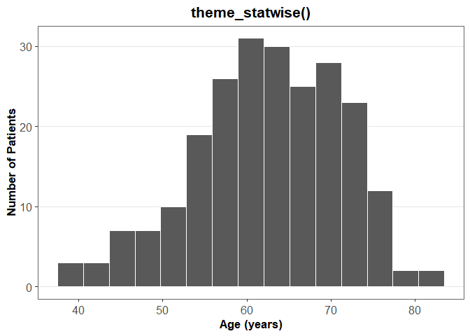

### Example 2: Patient Age by Survival Status and Sex

This example shows how `theme_statwise()` changes a faceted figure with
a legend.

``` r
lung_data$sex_group <- factor(
  lung_data$sex,
  levels = c(1, 2),
  labels = c("Male", "Female")
)

lung_data$status_group <- factor(
  lung_data$status,
  levels = c(1, 2),
  labels = c("Censored", "Event")
)

p_base <- ggplot(
  lung_data,
  aes(x = status_group, y = age, fill = status_group)
) +
  geom_boxplot() +
  facet_wrap(~ sex_group) +
  labs(
    x = "Survival Status",
    y = "Age (years)",
    fill = "Status"
  )

p_default <- p_base +
  labs(title = "Default ggplot2")

p_statwise <- p_base +
  labs(title = "theme_statwise()") +
  theme_statwise()

p_default
p_statwise
```

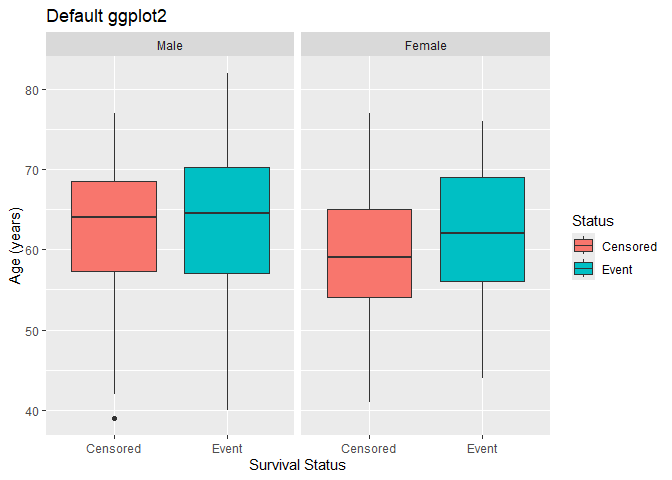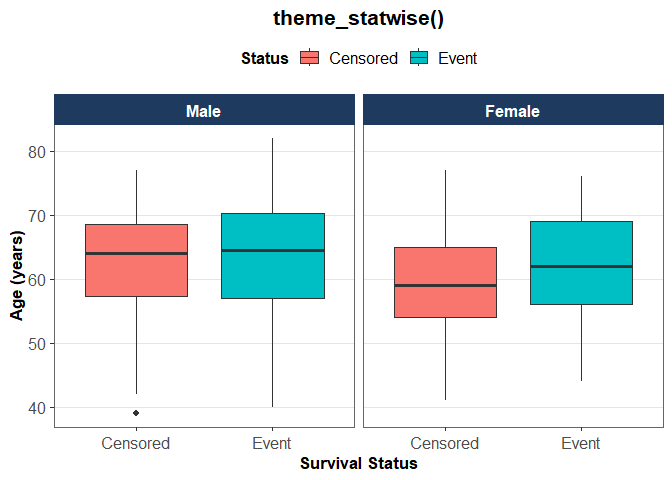

## Colors and Palettes

The `statwise` package provides a standardized color system for
consistent statistical and clinical research figures.

The color system includes master colors and predefined palettes for
categorical, sequential, and diverging data.

### Master Colors

The `statwise` package includes 15 master colors that can be accessed by
name using `statwise_colors()`.

Return all available colors:

``` r
statwise_colors()
#>   dark_blue medium_blue  light_blue       brick      orange        gold 
#>   "#00558C"   "#0078C4"   "#61B1FF"   "#BD472A"   "#E99328"   "#FFCD00" 
#>   dark_teal       green        teal    burgundy     magenta        pink 
#>   "#23545E"   "#1D8E4D"   "#53B0A8"   "#962352"   "#C92F6E"   "#FFAEC9" 
#>  light_gray        gray       black 
#>   "#E8E8E8"   "#63666A"   "#000000"
```

Select a single color:

``` r
statwise_colors("medium_blue")
#> [1] "#0078C4"
```

Select multiple colors:

``` r
statwise_colors(c("gold", "medium_blue", "green"))
#> [1] "#FFCD00" "#0078C4" "#1D8E4D"
```

To visually inspect all master colors, including their names and HEX
values:

``` r
show_statwise_colors()
```

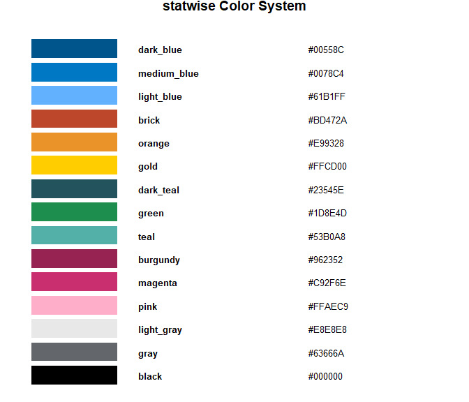

The returned colors can be used directly in plots. For example:

``` r
p_base <- ggplot(
  lung_data,
  aes(x = age)
) +
  geom_histogram(
    bins = 15,
    color = "white"
  ) +
  labs(
    x = "Age (years)",
    y = "Number of Patients"
  )

p_default <- p_base +
  labs(title = "Default ggplot2")

p_statwise <- p_base +
  geom_histogram(
    bins = 15,
    fill = statwise_colors("medium_blue"),
    color = "white"
  ) +
  labs(title = "statwise medium_blue") +
  theme_statwise()

p_default
p_statwise
```

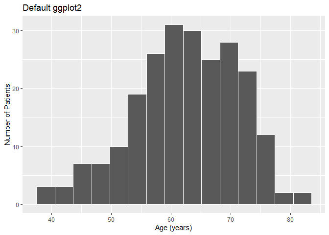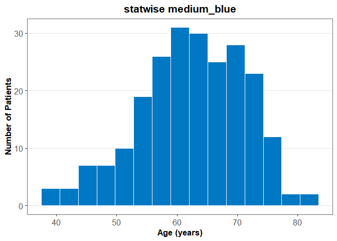

### Available Palettes

The package includes the following palettes:

| Type        | Palette           | Number of Colors |
|-------------|-------------------|-----------------:|
| Categorical | `primary`         |                5 |
| Categorical | `secondary`       |               15 |
| Sequential  | `blue_seq`        |                7 |
| Sequential  | `gold_seq`        |                7 |
| Diverging   | `gold_black_div`  |                9 |
| Diverging   | `red_blue_div`    |                9 |
| Diverging   | `green_brick_div` |                9 |

Use `statwise_palettes()` to retrieve the colors from a palette:

``` r
statwise_palettes("primary")
#> [1] "#23545E" "#53B0A8" "#FFCD00" "#61B1FF" "#00558C"
```

Use `show_statwise_palettes()` to visually display a palette with its
color names and hexadecimal values:

``` r
show_statwise_palettes("gold_seq")
```

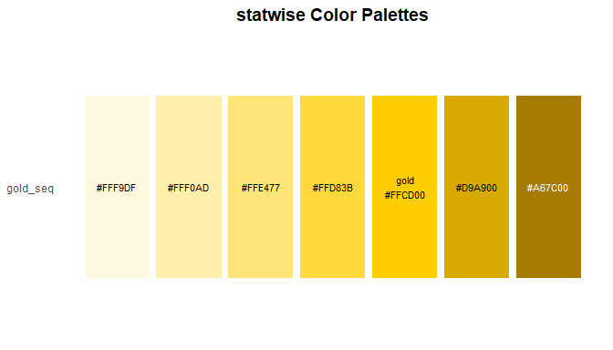

### Categorical Palettes

The `primary` palette contains five colors and is intended for plots
with a small number of distinct groups.

The `secondary` palette contains 15 colors and can be used when more
categories need to be distinguished.

``` r
show_statwise_palettes("primary")
```

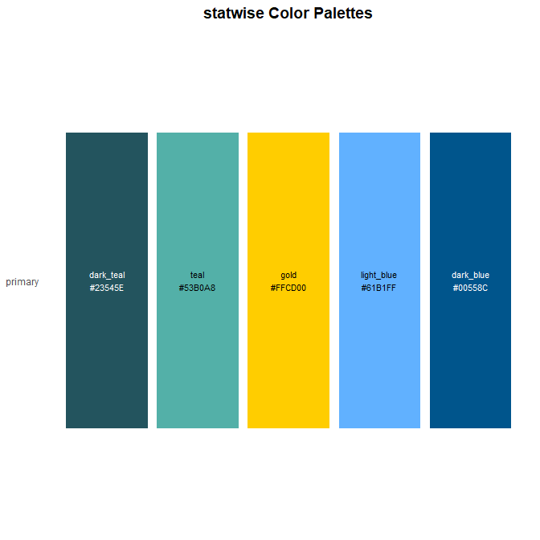

Categorical palettes can be used directly with ggplot2:

``` r
p_base <- ggplot(
  iris,
  aes(x = Species, y = Sepal.Length, fill = Species)
) +
  geom_boxplot() +
  labs(
    x = "Species",
    y = "Sepal Length",
    fill = "Species"
  )

p_default <- p_base +
  labs(title = "Default ggplot2")

p_statwise <- p_base +
  scale_fill_manual(
    values = statwise_palettes("primary")
  ) +
  labs(title = "statwise primary palette") +
  theme_statwise()

p_default
p_statwise
```

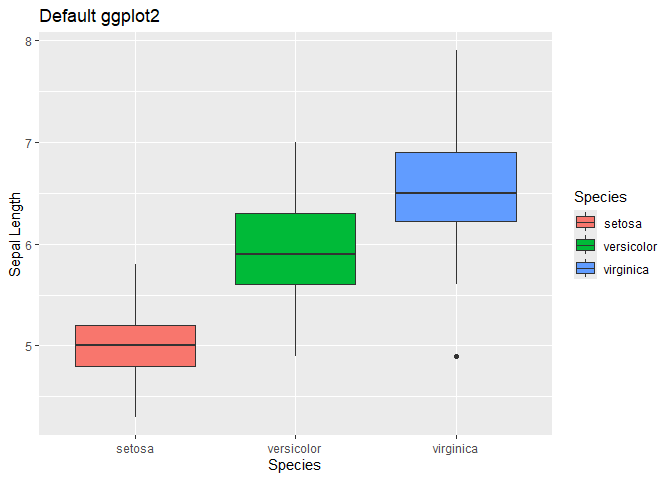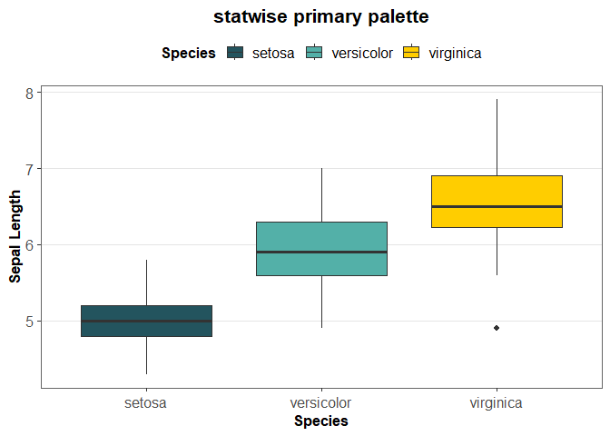

### Sequential Palettes

Sequential palettes progress from light to dark and are designed for
ordered or continuous values.

Available sequential palettes are:

- `blue_seq`
- `gold_seq`

``` r
show_statwise_palettes("blue_seq")
```

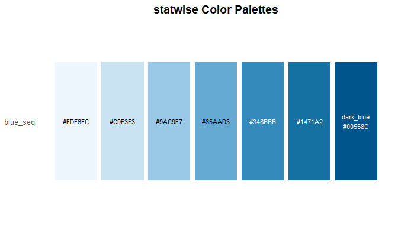

Sequential palettes can be used with continuous ggplot2 scales:

``` r
p_base <- ggplot(
  mtcars,
  aes(x = wt, y = mpg, color = hp)
) +
  geom_point(size = 3) +
  labs(
    x = "Weight",
    y = "Miles per Gallon",
    color = "Horsepower"
  )

p_default <- p_base +
  labs(title = "Default ggplot2")

p_statwise <- p_base +
  scale_color_gradientn(
    colors = statwise_palettes("blue_seq")
  ) +
  guides(
    color = guide_colorbar(
      barwidth = 10,
      barheight = 0.7
    )
  ) +
  labs(title = "statwise blue_seq palette") +
  theme_statwise()

p_default
p_statwise
```

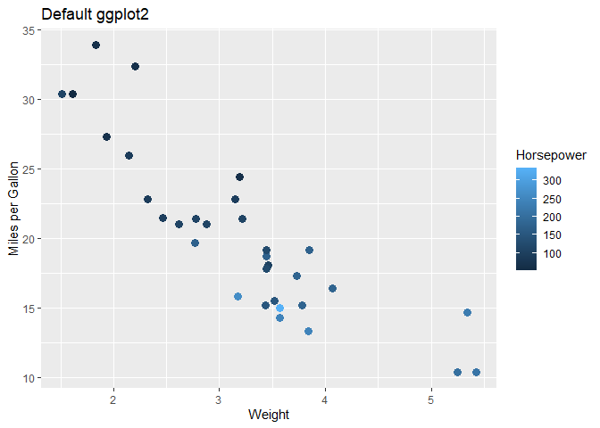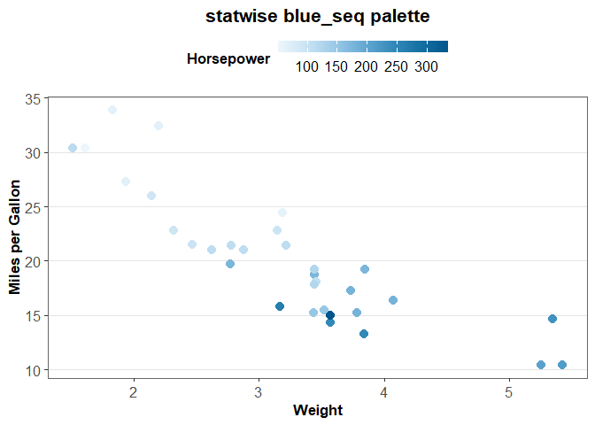

### Diverging Palettes

Diverging palettes use two contrasting color ranges separated by a
neutral midpoint. They are intended for values that diverge around a
meaningful center.

Available diverging palettes are:

- `gold_black_div`
- `red_blue_div`
- `green_brick_div`

``` r
show_statwise_palettes("red_blue_div")
```

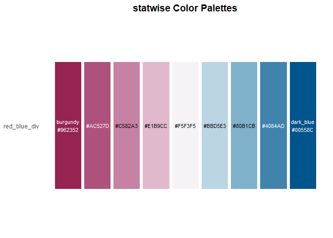

The palettes can be supplied directly to appropriate ggplot2 continuous
scales using `statwise_palettes()`.

``` r
set.seed(123)

change_data <- data.frame(
  patient = 1:40,
  change = rnorm(40, mean = 0, sd = 5)
)

p_base <- ggplot(
  change_data,
  aes(x = patient, y = change, fill = change)
) +
  geom_col() +
  labs(
    x = "Patient",
    y = "Change",
    fill = "Change"
  )

p_default <- p_base +
  labs(title = "Default ggplot2")

p_statwise <- p_base +
  scale_fill_gradientn(
    colors = statwise_palettes("gold_black_div"),
    values = scales::rescale(c(
      min(change_data$change),
      0,
      max(change_data$change)
    ))
  ) +
  labs(title = "statwise gold_black_div") +
  theme_statwise()

p_default
p_statwise
```

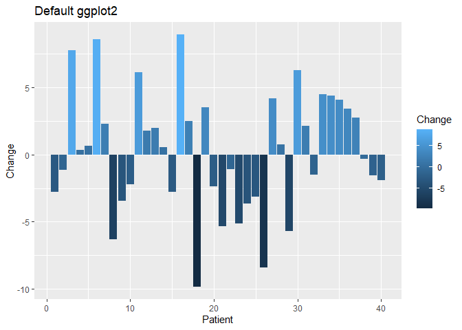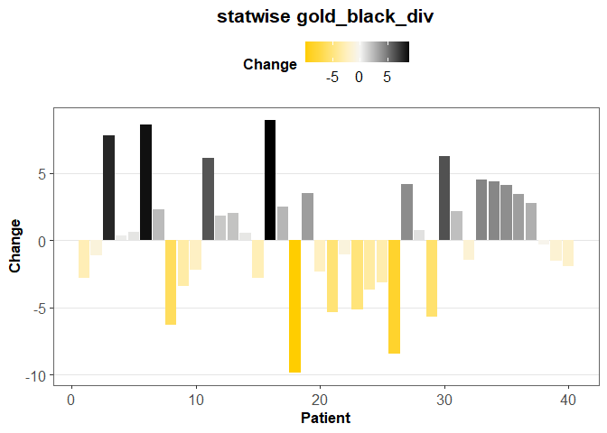

## Descriptive Summary Tables

The `statwise` package provides tools for generating descriptive
summaries in a standardized long format and converting them into
presentation-ready tables.

The following example uses the lung cancer dataset from the `survival`
package.

``` r
lung_data <- survival::lung

lung_data$sex <- factor(
  lung_data$sex,
  levels = c(1, 2),
  labels = c("Male", "Female")
)

lung_data$status <- factor(
  lung_data$status,
  levels = c(1, 2),
  labels = c("Censored", "Event")
)

summary_long <- summarize_variables(
  data = lung_data,
  variables = c("age", "status", "ph.ecog"),
  group = "sex",
  categorical = "status",
  ordinal = "ph.ecog",
  digits = 1,
  include_missing = TRUE,
  include_overall = TRUE,
  percent_denominator = "nonmissing"
)
```

The long-format output can then be converted into a descriptive table:

``` r
summary_table <- build_descriptive_table(
  long_summary_data = summary_long,
  group = "group",
  continuous_display = c(
    "Mean (SD)" = "{mean} ({sd})",
    "Median (Min, Max)" = "{median} ({min}, {max})"
  ),
  include_missing = TRUE
)

summary_table
#>      Characteristics   Overall (N=228)      Male (N=138)     Female (N=90)
#> 1                age                                                      
#> 2          Mean (SD)        62.4 (9.1)        63.3 (9.1)        61.1 (8.8)
#> 3  Median (Min, Max) 63.0 (39.0, 82.0) 64.0 (39.0, 82.0) 61.0 (41.0, 77.0)
#> 4             status                                                      
#> 5           Censored        63 (27.6%)        26 (18.8%)        37 (41.1%)
#> 6              Event       165 (72.4%)       112 (81.2%)        53 (58.9%)
#> 7            ph.ecog                                                      
#> 8                  0        63 (27.8%)        36 (26.3%)        27 (30.0%)
#> 9                  1       113 (49.8%)        71 (51.8%)        42 (46.7%)
#> 10                 2        50 (22.0%)        29 (21.2%)        21 (23.3%)
#> 11                 3          1 (0.4%)          1 (0.7%)          0 (0.0%)
#> 12           Missing                 1                 1                 0
```

Descriptive summaries and statistical testing are intentionally kept
separate, allowing users to select the appropriate statistical tests for
each analysis.

## SAS Integration

`statwise` includes utilities for working with SAS from R, including
running user-defined SAS macros. SAS must be installed and the
executable and macro-file paths configured. Some SAS data helpers still
have environment-specific defaults and are being generalized.

### SAS Data Helpers

`list_sas_data()` and `get_sas_data()` are included, but their default
paths and data-source conventions were originally designed for a
specific analysis environment. Review and configure these functions for
your own SAS installation and directory structure before using them.

### Running SAS Macros from R

The package can run user-defined SAS macros directly from R.

`list_sas_macros()` lists the macros available through a central SAS
macro file.

``` r
list_sas_macros(
  macro_file = "path/to/all_macros.sas"
)
```

For example, the result may include:

``` text
[1] "compare" "ordinal_mv" "ordinal_uv_cat" "ordinal_uv_cont"
```

`sas_macro_help()` can be used to view the arguments and available
example for a specific SAS macro before running it.

``` r
sas_macro_help(
  macro = "compare",
  macro_file = "path/to/all_macros.sas"
)
```

For example:

``` text
SAS Macro: compare

Arguments:
  base
  compare
  by
  out
```

Once the required arguments are known, `run_sas_macro()` runs the macro
directly from R.

``` r
run_sas_macro(
  macro = "compare",
  macro_file = "path/to/all_macros.sas",
  sas_exe = "path/to/sas.exe",
  base = "path/to/base.csv",
  compare = "path/to/compare.sas7bdat",
  by = "patno event_id",
  out = "path/to/compare.rtf"
)
```

R data frames can also be passed directly as macro arguments. The
function temporarily makes them available to SAS as SAS datasets before
running the macro.

``` r
run_sas_macro(
  macro = "compare",
  macro_file = "path/to/all_macros.sas",
  sas_exe = "path/to/sas.exe",
  base = my_r_data,
  compare = "path/to/compare.sas7bdat",
  by = "patno event_id",
  out = "path/to/compare.rtf"
)
```

## Utility Functions

### Clear Environment

`clear_env()` provides a convenient way to remove all objects from the R
global environment.

``` r
clear_env()
```

This is equivalent to:

``` r
rm(list = ls())
```

### Clean Data

`clean_data()` performs basic cleaning and standardization of a data
frame. It converts variable names to lowercase, trims leading and
trailing whitespace from character variables, replaces empty character
strings with `NA`, and sorts variables alphabetically by name.

``` r
dat <- data.frame(
  Name = c(" John ", "", "Mary"),
  Age = c(30, 25, 40),
  City = c(" Miami ", "Los Angeles", "")
)

clean_data(dat)
#>   age        city name
#> 1  30       Miami John
#> 2  25 Los Angeles <NA>
#> 3  40        <NA> Mary
```

### Remove Attributes

`remove_attributes()` removes column attributes from a data frame to
facilitate data comparisons using `all.equal()`. This is particularly
useful when comparing datasets imported from SAS with datasets created
in R, where differences in attributes may cause comparisons to fail even
when the underlying values are identical.

``` r
sas_data <- data.frame(id = 1:3, score = c(85, 90, 95))
r_data <- data.frame(id = 1:3, score = c(85, 90, 95))

attr(sas_data$score, "label") <- "Test Score"

all.equal(sas_data, r_data)
#> [1] "Component \"score\": Attributes: < Modes: list, NULL >"                   
#> [2] "Component \"score\": Attributes: < Lengths: 1, 0 >"                       
#> [3] "Component \"score\": Attributes: < names for target but not for current >"
#> [4] "Component \"score\": Attributes: < current is not list-like >"

all.equal(remove_attributes(sas_data), remove_attributes(r_data))
#> [1] TRUE
```

### Check Missing Values

`check_missing()` provides a variable-level summary of missing values
and empty strings. It reports variable names, data types, missing
counts, missing percentages, and empty string counts.

``` r
dat <- data.frame(
  Name = c("John", NA, "", "Mary"),
  Age = c(30, NA, 40, 25),
  City = c("Iowa City", "", NA, "Milan")
)

check_missing(dat)
#>   variable      type n_missing pct_missing n_empty_string
#> 1     Name character         1          25              1
#> 2      Age   numeric         1          25              -
#> 3     City character         1          25              1
```

## Package Development

Additional functions and documentation will be added as the package
develops.
